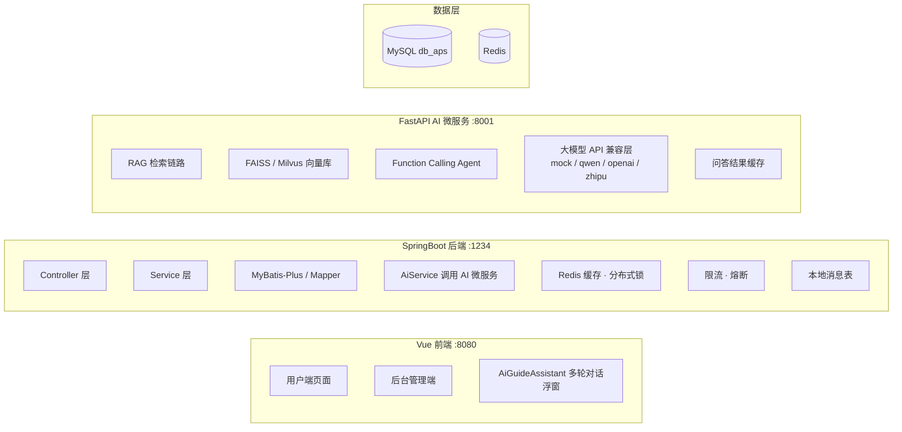

# AI 智能商品销售系统

一个在传统电商系统上扩展 AI 能力的全栈项目。系统由 Vue 前端、SpringBoot 后端、MySQL 数据库与独立 FastAPI AI 微服务组成。系统提供智能导购、AI 文案生成、AI 销售分析三大能力。

## 核心功能

电商业务

- 用户端：商品浏览、分类搜索、购物车、收藏、下单支付、评价、物流跟踪
- 后台：商品、分类、订单、库存、公告、轮播图、用户与角色权限管理
- ECharts 销售统计可视化

AI 能力

- AI 智能导购：基于自然语言需求，结合商品向量检索与大模型生成推荐
- AI 商品文案生成：自动生成标题、简介、详情与营销语
- AI 销售分析：输出热销分析、库存预警与补货建议
- 多轮对话 + SSE 流式输出：导购支持会话上下文，回答打字机式返回
- 混合检索 + 语义精排：向量与关键词多路召回，RRF 融合 + Rerank 精排
- Function Calling Agent：AI 可调用商品查询、库存查询等工具

高并发与生产级能力

- MQ 异步下单：RabbitMQ 削峰解耦，Redis 预扣库存防超卖，延迟队列超时关单
- 订单状态机：待支付 → 已支付 → 已发货 → 已完成 / 已取消 / 退款中 → 已退款
- 缓存三防：布隆过滤器防穿透、互斥锁双检防击穿、TTL 抖动防雪崩
- 限流熔断降级：令牌桶限流、滑动窗口熔断、AI 服务降级兜底
- 可靠消息：雪花 ID、接口幂等、本地消息表最终一致性
- 可观测性：TraceId 全链路透传、Micrometer 指标、Prometheus + Grafana 监控

## 系统架构



架构要点

- 前端不直接调用 FastAPI，SpringBoot 作为网关统一收敛 `/ai/` 请求
- SpringBoot 不直接调用大模型 API，AI 能力全部收敛在 Python 微服务
- 三层解耦：更换向量库、升级模型或新增 AI 功能，只需改动 AI 微服务

## 技术栈

| 前端 | Vue 2 · Element UI · Axios · ECharts · Vue Router · Vuex |
| 后端 | Spring Boot 3.4 · MyBatis-Plus · Spring Security · JWT · Redis · Caffeine · RabbitMQ |
| AI 服务 | Python · FastAPI · LangChain · FAISS / Milvus · Pydantic |
| 数据库 | MySQL · Redis · RabbitMQ |

## 目录结构

```text
AI-Shopping-System/
├── springboot/         # SpringBoot 后端
├── vue/                # Vue 前端
├── ai-service/         # FastAPI AI 微服务
├── deploy/             # Docker / K8s / 监控部署
├── docs/               # 架构设计说明
├── perf/               # 压测脚本与实测数据
├── sql/                # 数据库脚本
└── README.md
```

## 快速开始

### 本地启动

1. MySQL：导入 `sql/db_aps.sql`，确认 `db_aps` 库可连接。

2. AI 微服务（端口 8001）

```bash
cd ai-service
python -m venv .venv
.\.venv\Scripts\activate
pip install -r requirements.txt
copy .env.example .env
python scripts/init_vector_store.py
uvicorn app.main:app --host 0.0.0.0 --port 8001
```

3. SpringBoot 后端（端口 1234）

```bash
cd springboot
mvn spring-boot:run
```

4. Vue 前端（端口 8080）

```bash
cd vue
npm install
npm run serve
```

访问：前端 `http://localhost:8080` · 后端接口 `http://localhost:1234` · AI 服务 `http://localhost:8001/docs`

## 更多文档

- [架构设计说明](docs/架构设计说明.md)
- [Docker 部署说明](deploy/README.md)
- [性能压测与实测数据](perf/README.md)
